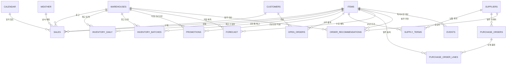

# Mart AI ERP 데이터베이스 설계서 (PostgreSQL)

본 문서는 **ERP 기반 AI 수요 예측 및 자동 발주 시스템(Mart AI ERP)**의 데이터베이스 설계서입니다.  
`수요예측 데이터 명세.md`와 마트 운영 비즈니스 로직(로트/유통기한, 발주 주기, 안전재고 등)을 종합하여 **PostgreSQL 16+** 환경 및 **Docker 컨테이너** 배포에 최적화하여 작성되었습니다.

---

## 1. DB 설계 원칙 및 아키텍처

### 1.1 기본 규칙 및 데이터 타입 매핑
| 항목 | 설계 표준 | PostgreSQL 타입 | 비고 |
|---|---|---|---|
| **날짜/일시** | 날짜: `YYYY-MM-DD`<br>일시: `YYYY-MM-DD HH24:MI:SS` (KST) | `DATE`<br>`TIMESTAMPTZ` (기본값: `CURRENT_TIMESTAMP`) | 시간대(`Asia/Seoul`) 명시 처리 |
| **식별자 (ID)** | 업무 식별자 코드 (앞자리 `0` 보존, 접두사 포함) | `VARCHAR(30)` ~ `VARCHAR(50)` | 예: `ITM-00123`, `SO-250314-0012` |
| **수량** | 소수점 3자리 지원 (kg, L 등 소수 단위 품목 대응) | `NUMERIC(12, 3)` | 기본값: `0.000` |
| **금액/단가** | 원화(KRW) 정수 단위 저장 | `BIGINT` / `INTEGER` | 총액은 잠재적 확장을 위해 `BIGINT` 고려 |
| **비율/확률** | 0.0 ~ 1.0 (예: 할인율 20% = 0.2000) | `NUMERIC(5, 4)` | `CHECK (col >= 0 AND col <= 1)` |
| **여부(Flag)** | 참/거짓 | `BOOLEAN` | 기본값: `FALSE` |
| **범주(Enum)** | 정해진 코드 집합 | `VARCHAR(30)` + `CHECK 제약조건` | 마이그레이션 유연성을 위해 CHECK 권장 |
| **기본 분석 단위** | **일자(Date) × 품목(Item) × 창고/지점(Warehouse)** | 복합 유니크/인덱스 키 구성 | 시계열 타깃 분석 Grain |

### 1.2 성능 및 파티셔닝 전략
1. **시계열 대용량 테이블 파티셔닝 (Range Partitioning)**:
   - `sales` (판매 이력) 및 `inventory_daily` (일별 재고 스냅샷)는 데이터가 매일 누적되므로 `sale_date`, `snapshot_date` 기준 **월별(Range by Month) 선언적 파티셔닝**을 적용합니다.
2. **복합 인덱스 (Composite Indexes)**:
   - AI 피처 추출 쿼리의 핵심 패턴인 `(item_id, warehouse_id, date)` 조합에 대해 B-Tree 인덱스를 필수로 구성합니다.
3. **품절 처리 및 가중치**:
   - `stockout_flag`를 관리하여 학습 시 가중치 0 처리 또는 수요 복원(Imputation) 시 필터 조건으로 즉시 활용할 수 있도록 인덱싱합니다.

---

## 2. ERD (Entity Relationship Diagram)



---

## 3. 데이터 모델 상세 명세 (Data Dictionary)

### 3.1 기준 마스터 (Master Data)

#### 1) 창고 / 매장 지점 마스터 (`warehouses`)
각 지점 및 물류창고의 정보를 관리합니다.
| 컬럼명 | 데이터 타입 | 제약 조건 | 설명 |
|---|---|---|---|
| `warehouse_id` | `VARCHAR(30)` | **PK** | 창고/지점 코드 (예: `WH-ASAN`, `MART-GANGNAM`) |
| `warehouse_name` | `VARCHAR(100)` | NOT NULL | 창고/매장명 |
| `region_code` | `VARCHAR(20)` | NOT NULL | 지역 관측 코드 (기상청 및 행정코드 매핑) |
| `address` | `VARCHAR(255)` | NULL | 상세 주소 |
| `is_active` | `BOOLEAN` | NOT NULL DEFAULT TRUE | 운영 여부 |
| `created_at` | `TIMESTAMPTZ` | NOT NULL DEFAULT CURRENT_TIMESTAMP | 등록 일시 |

#### 2) 거래처 / 고객 마스터 (`customers`)
B2B 납품 거래처 및 멤버십 고객 분류 마스터입니다.
| 컬럼명 | 데이터 타입 | 제약 조건 | 설명 |
|---|---|---|---|
| `customer_id` | `VARCHAR(30)` | **PK** | 거래처 코드 (예: `CUS-0045`) |
| `customer_name` | `VARCHAR(100)` | NOT NULL | 거래처/고객명 |
| `customer_type` | `VARCHAR(30)` | NOT NULL, CHECK | 유형 (`retail`, `restaurant`, `wholesale`, `online`) |
| `region_code` | `VARCHAR(20)` | NULL | 행정구역 지역코드 |
| `segment` | `VARCHAR(10)` | NULL, CHECK | 매출 등급 (`A`, `B`, `C`) |
| `first_order_date` | `DATE` | NULL | 최초 거래일 |
| `is_active` | `BOOLEAN` | NOT NULL DEFAULT TRUE | 거래 활성 여부 |
| `created_at` | `TIMESTAMPTZ` | NOT NULL DEFAULT CURRENT_TIMESTAMP | 등록 일시 |

#### 3) 공급업체 마스터 (`suppliers`)
물품을 공급하는 납품업체 마스터입니다.
| 컬럼명 | 데이터 타입 | 제약 조건 | 설명 |
|---|---|---|---|
| `supplier_id` | `VARCHAR(30)` | **PK** | 공급업체 코드 (예: `SUP-007`) |
| `supplier_name` | `VARCHAR(100)` | NOT NULL | 공급사 상호명 |
| `lead_time_days` | `INTEGER` | NOT NULL DEFAULT 1 | 기본 리드타임 (발주~입고 소요일) |
| `cutoff_time` | `TIME` | NULL DEFAULT '18:00:00' | 당일 발주 마감 시각 |
| `min_order_amount` | `BIGINT` | NOT NULL DEFAULT 0 | 최소 발주 금액 기준 |
| `phone` | `VARCHAR(30)` | NULL | 연락처 |
| `is_active` | `BOOLEAN` | NOT NULL DEFAULT TRUE | 공급 거래 여부 |
| `created_at` | `TIMESTAMPTZ` | NOT NULL DEFAULT CURRENT_TIMESTAMP | 등록 일시 |

#### 4) 품목 마스터 (`items`)
ERP 관리 품목 및 AI 계층 예측/대체 그룹 정보를 관리합니다.
| 컬럼명 | 데이터 타입 | 제약 조건 | 설명 |
|---|---|---|---|
| `item_id` | `VARCHAR(30)` | **PK** | 품목 식별 코드 (예: `ITM-00123`) |
| `item_name` | `VARCHAR(150)` | NOT NULL | 품목명 (예: `냉동 만두 1kg`) |
| `category_l` | `VARCHAR(50)` | NOT NULL | 대분류 (예: `식품`, `채소·과일`) |
| `category_m` | `VARCHAR(50)` | NULL | 중분류 (예: `냉동`, `정육·계란`) |
| `category_s` | `VARCHAR(50)` | NULL | 소분류 (예: `만두`, `수입우육`) |
| `uom` | `VARCHAR(20)` | NOT NULL | 관리 단위 (`EA`, `BOX`, `KG`, `L`, `단`, `봉`) |
| `pack_size` | `NUMERIC(12, 3)` | NOT NULL DEFAULT 1.000 | 1박스/포장당 입수량 |
| `cost_price` | `BIGINT` | NOT NULL DEFAULT 0 | 기준 매입 원가 |
| `sale_price` | `BIGINT` | NOT NULL DEFAULT 0 | 정상 판매가 |
| `shelf_life_days` | `INTEGER` | NULL | 소비기한/유통기한(일). 없으면 NULL |
| `launch_date` | `DATE` | NULL | 상품 출시일 |
| `discontinue_date` | `DATE` | NULL | 상품 단종일 |
| `substitute_group`| `VARCHAR(50)` | NULL | 대체 가능 품목군 코드 (예: `SUB-DUMPLING`) |
| `safety_stock` | `NUMERIC(12, 3)` | NOT NULL DEFAULT 0.000 | 권장 안전재고 수량 |
| `created_at` | `TIMESTAMPTZ` | NOT NULL DEFAULT CURRENT_TIMESTAMP | 등록 일시 |

#### 5) 공급 조건 마스터 (`supply_terms`)
품목별 공급처 계약 조건입니다. AI 예측값을 실제 발주량으로 변환하는 핵심 공식 변수입니다.
| 컬럼명 | 데이터 타입 | 제약 조건 | 설명 |
|---|---|---|---|
| `item_id` | `VARCHAR(30)` | **PK**, FK(`items`) | 품목 코드 |
| `supplier_id` | `VARCHAR(30)` | **PK**, FK(`suppliers`) | 공급업체 코드 |
| `is_primary` | `BOOLEAN` | NOT NULL DEFAULT TRUE | 주 공급사 여부 |
| `lead_time_days` | `INTEGER` | NOT NULL DEFAULT 1 | 해당 품목 기준 계약 리드타임(일) |
| `moq` | `NUMERIC(12, 3)` | NOT NULL DEFAULT 1.000 | 최소 주문 수량 (MOQ) |
| `order_multiple` | `NUMERIC(12, 3)` | NOT NULL DEFAULT 1.000 | 발주 단위 배수 (박스 단위 배수) |
| `unit_cost` | `BIGINT` | NOT NULL | 매입 단가 |
| `order_days` | `VARCHAR(50)` | NULL DEFAULT 'MON,TUE,WED,THU,FRI' | 발주 가능 요일 (쉼표 구분) |

---

### 3.2 트랜잭션 및 재고 관리

#### 6) 판매(출고) 이력 (`sales`)
수요 예측 모델의 타깃(Target)이 되는 핵심 원장 테이블입니다.
> **성능 최적화**: `sale_date` 기준 파티셔닝 권장
| 컬럼명 | 데이터 타입 | 제약 조건 | 설명 |
|---|---|---|---|
| `id` | `BIGSERIAL` | **PK (복합)** | 내부 순번 |
| `sale_date` | `DATE` | **PK (복합)** | 출고/판매 일자 |
| `order_id` | `VARCHAR(50)` | NOT NULL | 판매 주문 번호 (예: `SO-250314-0012`) |
| `item_id` | `VARCHAR(30)` | NOT NULL, FK(`items`) | 품목 코드 |
| `warehouse_id` | `VARCHAR(30)` | NOT NULL, FK(`warehouses`) | 출고 창고/지점 |
| `customer_id` | `VARCHAR(30)` | NULL, FK(`customers`) | 구매 거래처/고객 |
| `channel` | `VARCHAR(20)` | NOT NULL, CHECK | 판매 채널 (`offline`, `online`, `b2b`) |
| `qty` | `NUMERIC(12, 3)` | NOT NULL | 판매 수량 |
| `unit_price` | `BIGINT` | NOT NULL | 실제 판매 단가 |
| `amount` | `BIGINT` | NOT NULL | 결제 금액 (`qty * unit_price`) |
| `is_return` | `BOOLEAN` | NOT NULL DEFAULT FALSE | 반품 여부 (반품 시 TRUE) |
| `created_at` | `TIMESTAMPTZ` | NOT NULL DEFAULT CURRENT_TIMESTAMP | 등록 일시 |

#### 7) 일별 재고 스냅샷 (`inventory_daily`)
품절 보정 및 자동 발주의 기준점이 되는 일일 마감 재고입니다.
| 컬럼명 | 데이터 타입 | 제약 조건 | 설명 |
|---|---|---|---|
| `snapshot_date` | `DATE` | **PK** | 기준일 (일마감 기준) |
| `item_id` | `VARCHAR(30)` | **PK**, FK(`items`) | 품목 코드 |
| `warehouse_id` | `VARCHAR(30)` | **PK**, FK(`warehouses`) | 창고/지점 코드 |
| `on_hand_qty` | `NUMERIC(12, 3)` | NOT NULL DEFAULT 0.000 | 물리적 실재고 수량 |
| `available_qty` | `NUMERIC(12, 3)` | NOT NULL DEFAULT 0.000 | 가용 재고 (출고예정분 제외) |
| `stockout_flag` | `BOOLEAN` | NOT NULL DEFAULT FALSE | 당일 품절 발생 여부 (수요 결손 보정용) |

#### 8) 로트/소비기한별 실재고 (`inventory_batches`)
마트 ERP의 핵심인 상품 유통기한/소비기한별 재고 관리 테이블입니다.
| 컬럼명 | 데이터 타입 | 제약 조건 | 설명 |
|---|---|---|---|
| `batch_id` | `VARCHAR(50)` | **PK** | 로트 식별 ID (예: `BAT-250314-001`) |
| `item_id` | `VARCHAR(30)` | NOT NULL, FK(`items`) | 품목 코드 |
| `warehouse_id` | `VARCHAR(30)` | NOT NULL, FK(`warehouses`) | 보관 창고/지점 |
| `expiry_date` | `DATE` | NOT NULL | 소비기한/유통기한 |
| `qty` | `NUMERIC(12, 3)` | NOT NULL DEFAULT 0.000 | 로트 현재 잔여 수량 |
| `received_date`| `DATE` | NOT NULL DEFAULT CURRENT_DATE | 입고일 |
| `updated_at` | `TIMESTAMPTZ` | NOT NULL DEFAULT CURRENT_TIMESTAMP | 변경 일시 |

#### 9) 확정 주문 잔량 (`open_orders`)
B2B 수주 잔량 등 이미 확정된 미래 수요입니다.
| 컬럼명 | 데이터 타입 | 제약 조건 | 설명 |
|---|---|---|---|
| `order_id` | `VARCHAR(50)` | NOT NULL | 주문 번호 |
| `line_no` | `INTEGER` | NOT NULL DEFAULT 1 | 주문 라인 번호 |
| `customer_id` | `VARCHAR(30)` | NOT NULL, FK(`customers`) | 거래처 코드 |
| `item_id` | `VARCHAR(30)` | NOT NULL, FK(`items`) | 품목 코드 |
| `order_date` | `DATE` | NOT NULL | 주문 접수일 |
| `requested_delivery_date` | `DATE` | NOT NULL | 납기 요청일 |
| `qty` | `NUMERIC(12, 3)` | NOT NULL | 주문 수량 |
| `status` | `VARCHAR(20)` | NOT NULL, CHECK | 상태 (`confirmed`, `shipped`, `cancelled`) |
| PRIMARY KEY | `(order_id, line_no)` | | |

#### 10) 발주 헤더 및 품목 (`purchase_orders`, `purchase_order_lines`)
공급사에 발주한 내역과 실제 입고 리드타임 통계 분석용 테이블입니다.
- **`purchase_orders` (발주 헤더)**:
  | 컬럼명 | 데이터 타입 | 제약 조건 | 설명 |
  |---|---|---|---|
  | `po_id` | `VARCHAR(50)` | **PK** | 발주 번호 (예: `PO-250310-0004`) |
  | `supplier_id` | `VARCHAR(30)` | NOT NULL, FK(`suppliers`) | 공급업체 |
  | `order_date` | `DATE` | NOT NULL | 발주일 |
  | `expected_date`| `DATE` | NOT NULL | 입고 예정일 |
  | `received_date`| `DATE` | NULL | 실제 입고 완료일 |
  | `total_amount` | `BIGINT` | NOT NULL DEFAULT 0 | 총 발주 금액 |
  | `status` | `VARCHAR(20)` | NOT NULL, CHECK | 상태 (`draft`, `ordered`, `partial`, `received`, `cancelled`) |
  | `created_at` | `TIMESTAMPTZ` | NOT NULL DEFAULT CURRENT_TIMESTAMP | 등록 일시 |

- **`purchase_order_lines` (발주 상세 라인)**:
  | 컬럼명 | 데이터 타입 | 제약 조건 | 설명 |
  |---|---|---|---|
  | `po_id` | `VARCHAR(50)` | **PK**, FK(`purchase_orders`) | 발주 번호 |
  | `line_no` | `INTEGER` | **PK** | 라인 번호 |
  | `item_id` | `VARCHAR(30)` | NOT NULL, FK(`items`) | 품목 코드 |
  | `order_qty` | `NUMERIC(12, 3)` | NOT NULL | 발주 수량 |
  | `received_qty` | `NUMERIC(12, 3)` | NOT NULL DEFAULT 0.000 | 실제 입고 수량 |
  | `unit_cost` | `BIGINT` | NOT NULL | 매입 단가 |

---

### 3.3 시계열 외생 변수 (External Features)

#### 11) 가격 및 프로모션 (`promotions`)
| 컬럼명 | 데이터 타입 | 제약 조건 | 설명 |
|---|---|---|---|
| `promo_id` | `VARCHAR(50)` | **PK** | 행사 번호 (예: `PR-2503-01`) |
| `item_id` | `VARCHAR(30)` | NOT NULL, FK(`items`) | 행사 대상 품목 |
| `warehouse_id` | `VARCHAR(30)` | NULL, FK(`warehouses`) | 적용 지점 (NULL이면 전 지점 적용) |
| `start_date` | `DATE` | NOT NULL | 행사 시작일 |
| `end_date` | `DATE` | NOT NULL | 행사 종료일 |
| `promo_type` | `VARCHAR(30)` | NOT NULL, CHECK | 행사 유형 (`discount`, `one_plus_one`, `bundle`, `coupon`, `display`) |
| `regular_price` | `BIGINT` | NOT NULL | 정상 판매가 |
| `promo_price` | `BIGINT` | NOT NULL | 행사 판매가 |
| `discount_rate` | `NUMERIC(5, 4)`| NOT NULL | 할인율 (0.0000 ~ 1.0000) |

#### 12) 캘린더 마스터 (`calendar`)
특일 정보, 명절 D-Day 계산 등이 사전 적재되는 달력 테이블입니다.
| 컬럼명 | 데이터 타입 | 제약 조건 | 설명 |
|---|---|---|---|
| `date` | `DATE` | **PK** | 기준 일자 |
| `weekday` | `INTEGER` | NOT NULL, CHECK | 0(월요일) ~ 6(일요일) |
| `week_of_year` | `INTEGER` | NOT NULL | ISO 주차 번호 |
| `month` | `INTEGER` | NOT NULL | 월 (1~12) |
| `is_holiday` | `BOOLEAN` | NOT NULL DEFAULT FALSE | 공휴일 여부 |
| `holiday_name` | `VARCHAR(50)` | NULL | 공휴일 명칭 |
| `days_to_seollal`| `INTEGER` | NULL | 설날까지 남은 일수 (D-Day, 경과 시 음수) |
| `days_to_chuseok`| `INTEGER` | NULL | 추석까지 남은 일수 (D-Day) |
| `is_payday` | `BOOLEAN` | NOT NULL DEFAULT FALSE | 급여일 여부 (통상 25일/말일) |
| `season` | `VARCHAR(20)` | NOT NULL, CHECK | 계절 (`spring`, `summer`, `autumn`, `winter`) |

#### 13) 날씨 실측 및 단기예보 (`weather`, `weather_forecast`)
- **`weather` (과거 일별 실측)**:
  | 컬럼명 | 데이터 타입 | 제약 조건 | 설명 |
  |---|---|---|---|
  | `date` | `DATE` | **PK** | 관측 일자 |
  | `region_code` | `VARCHAR(20)` | **PK** | 기상 관측 지점 코드 (예: `232` 천안) |
  | `temp_avg` | `NUMERIC(4, 1)` | NULL | 평균 기온 (℃) |
  | `temp_min` | `NUMERIC(4, 1)` | NULL | 최저 기온 (℃) |
  | `temp_max` | `NUMERIC(4, 1)` | NULL | 최고 기온 (℃) |
  | `precipitation_mm`| `NUMERIC(6, 1)`| NOT NULL DEFAULT 0.0 | 강수량 (mm) |
  | `is_rain` | `BOOLEAN` | NOT NULL DEFAULT FALSE | 강수 발생 여부 |

- **`weather_forecast` (기상청 예보 스냅샷)**:
  | 컬럼명 | 데이터 타입 | 제약 조건 | 설명 |
  |---|---|---|---|
  | `issued_at` | `TIMESTAMPTZ` | **PK** | 예보 발표 일시 |
  | `target_date` | `DATE` | **PK** | 예보 대상 일자 |
  | `region_code` | `VARCHAR(20)` | **PK** | 지역 격자/지점 코드 |
  | `source` | `VARCHAR(20)` | NOT NULL, CHECK | 예보 소스 (`short`, `mid`, `normal`) |
  | `temp_max` | `NUMERIC(4, 1)` | NULL | 최고 기온 예보 |
  | `temp_min` | `NUMERIC(4, 1)` | NULL | 최저 기온 예보 |
  | `pop` | `NUMERIC(5, 4)` | NULL | 강수 확률 (0.0000 ~ 1.0000) |
  | `pcp_mm` | `NUMERIC(6, 1)` | NULL | 강수량 수치 변환값 (mm) |

#### 14) 이벤트 및 특이사항 로그 (`events`)
이상치 필터링 및 LLM 분석 연계를 위한 메모 로그입니다.
| 컬럼명 | 데이터 타입 | 제약 조건 | 설명 |
|---|---|---|---|
| `event_id` | `VARCHAR(50)` | **PK** | 이벤트 식별자 (예: `EV-0012`) |
| `start_date` | `DATE` | NOT NULL | 시작일 |
| `end_date` | `DATE` | NOT NULL | 종료일 |
| `item_id` | `VARCHAR(30)` | NULL, FK(`items`) | 대상 품목 (NULL이면 전체 영향) |
| `warehouse_id` | `VARCHAR(30)` | NULL, FK(`warehouses`) | 대상 창고 (NULL이면 전체 영향) |
| `event_type` | `VARCHAR(30)` | NOT NULL, CHECK | 유형 (`one_off_bulk`, `system_down`, `supply_issue`, `competitor`, `media`, `weather_disaster`) |
| `note` | `TEXT` | NOT NULL | 상세 내용 (자유 기술 메모) |

---

### 3.4 AI 모델 예측 및 자동 발주 결과

#### 15) AI 수요 예측 결과 (`forecast`)
수요 예측 모델(LightGBM 등)이 일괄 추론(Batch Inference)한 예측치 테이블입니다.
| 컬럼명 | 데이터 타입 | 제약 조건 | 설명 |
|---|---|---|---|
| `forecast_id` | `BIGSERIAL` | **PK** | 시퀀스 식별자 |
| `run_date` | `DATE` | NOT NULL | 예측 모델 실행일 |
| `target_date` | `DATE` | NOT NULL | 예측 대상 일자 |
| `item_id` | `VARCHAR(30)` | NOT NULL, FK(`items`) | 품목 코드 |
| `warehouse_id` | `VARCHAR(30)` | NOT NULL, FK(`warehouses`) | 창고/지점 코드 |
| `yhat` | `NUMERIC(12, 3)` | NOT NULL | 수량 예측값 (중앙값 / p50) |
| `yhat_p10` | `NUMERIC(12, 3)` | NULL | 하위 10% 예측값 (비관치) |
| `yhat_p90` | `NUMERIC(12, 3)` | NULL | 상위 10% 예측값 (안전재고 산출 기준) |
| `model_version`| `VARCHAR(50)` | NOT NULL | 사용된 모델 버전 (예: `lgbm-v3`) |
| `created_at` | `TIMESTAMPTZ` | NOT NULL DEFAULT CURRENT_TIMESTAMP | 등록 일시 |
| **UNIQUE** | `(run_date, target_date, item_id, warehouse_id)` | | 멱등성 보장 유니크 키 |

#### 16) 자동 발주 추천 내역 (`order_recommendations`)
예측값, 리드타임, 안전재고, MOQ, 배수 단위를 반영하여 자동 계산된 발주 초안입니다.
| 컬럼명 | 데이터 타입 | 제약 조건 | 설명 |
|---|---|---|---|
| `rec_id` | `VARCHAR(50)` | **PK** | 추천 번호 (예: `REC-250314-0001`) |
| `recommend_date`| `DATE` | NOT NULL | 추천 생성 일자 |
| `item_id` | `VARCHAR(30)` | NOT NULL, FK(`items`) | 품목 코드 |
| `warehouse_id` | `VARCHAR(30)` | NOT NULL, FK(`warehouses`) | 입고 대상 지점 |
| `supplier_id` | `VARCHAR(30)` | NOT NULL, FK(`suppliers`) | 공급업체 |
| `current_stock` | `NUMERIC(12, 3)` | NOT NULL | 계산 당시 현재 가용재고 |
| `forecast_demand`| `NUMERIC(12, 3)`| NOT NULL | 리드타임 기간 총 예상 수요 |
| `safety_stock` | `NUMERIC(12, 3)` | NOT NULL | 적용된 안전재고 |
| `recommended_qty`| `NUMERIC(12, 3)`| NOT NULL | 최종 추천 발주 수량 (MOQ/배수 보정 완료) |
| `status` | `VARCHAR(20)` | NOT NULL DEFAULT 'draft', CHECK | 상태 (`draft`, `approved`, `rejected`, `ordered`) |
| `reason` | `TEXT` | NULL | LLM/엔진 산출 근거 (예: "3일 뒤 폭염 예보 및 안전재고 보충") |
| `created_at` | `TIMESTAMPTZ` | NOT NULL DEFAULT CURRENT_TIMESTAMP | 등록 일시 |

---

## 4. 인덱스 및 성능 최적화 설계

### 4.1 핵심 쿼리 패턴과 인덱스 전략
1. **일별 품목 집계 조회 (`sales`)**:
   - `CREATE INDEX idx_sales_query ON sales (item_id, warehouse_id, sale_date);`
   - 피처 엔지니어링 시 특정 품목의 최근 7/14/28일 판매량을 롤링 집계할 때 풀스캔 방지.
2. **품절 보정 필터링 (`inventory_daily`)**:
   - `CREATE INDEX idx_inventory_daily_stockout ON inventory_daily (item_id, warehouse_id, snapshot_date) WHERE stockout_flag = TRUE;`
   - 부분 인덱스(Partial Index)를 활용하여 품절된 일자만 빠르게 추출.
3. **추천 발주 조회 (`order_recommendations`)**:
   - `CREATE INDEX idx_order_rec_status ON order_recommendations (recommend_date, status, supplier_id);`
   - 오늘 날짜의 '초안(draft)' 상태 발주 건들을 공급업체별로 묶어 UI에 표출.

---

## 5. PostgreSQL DDL 스크립트 (`init.sql`)

아래 스크립트는 도커 기동 시 `/docker-entrypoint-initdb.d/` 디렉터리에 마운트되어 데이터베이스 초기화를 자동으로 완료합니다.

```sql
-- ====================================================================
-- Mart AI ERP - PostgreSQL Database Initial Schema
-- ====================================================================

-- 1. 확장 기능 활성화
CREATE EXTENSION IF NOT EXISTS "uuid-ossp";

-- 2. 마스터 테이블 생성
CREATE TABLE IF NOT EXISTS warehouses (
    warehouse_id VARCHAR(30) PRIMARY KEY,
    warehouse_name VARCHAR(100) NOT NULL,
    region_code VARCHAR(20) NOT NULL,
    address VARCHAR(255),
    is_active BOOLEAN NOT NULL DEFAULT TRUE,
    created_at TIMESTAMPTZ NOT NULL DEFAULT CURRENT_TIMESTAMP
);

CREATE TABLE IF NOT EXISTS customers (
    customer_id VARCHAR(30) PRIMARY KEY,
    customer_name VARCHAR(100) NOT NULL,
    customer_type VARCHAR(30) NOT NULL CHECK (customer_type IN ('retail', 'restaurant', 'wholesale', 'online')),
    region_code VARCHAR(20),
    segment VARCHAR(10) CHECK (segment IN ('A', 'B', 'C')),
    first_order_date DATE,
    is_active BOOLEAN NOT NULL DEFAULT TRUE,
    created_at TIMESTAMPTZ NOT NULL DEFAULT CURRENT_TIMESTAMP
);

CREATE TABLE IF NOT EXISTS suppliers (
    supplier_id VARCHAR(30) PRIMARY KEY,
    supplier_name VARCHAR(100) NOT NULL,
    lead_time_days INTEGER NOT NULL DEFAULT 1 CHECK (lead_time_days >= 0),
    cutoff_time TIME DEFAULT '18:00:00',
    min_order_amount BIGINT NOT NULL DEFAULT 0,
    phone VARCHAR(30),
    is_active BOOLEAN NOT NULL DEFAULT TRUE,
    created_at TIMESTAMPTZ NOT NULL DEFAULT CURRENT_TIMESTAMP
);

CREATE TABLE IF NOT EXISTS items (
    item_id VARCHAR(30) PRIMARY KEY,
    item_name VARCHAR(150) NOT NULL,
    category_l VARCHAR(50) NOT NULL,
    category_m VARCHAR(50),
    category_s VARCHAR(50),
    uom VARCHAR(20) NOT NULL DEFAULT 'EA',
    pack_size NUMERIC(12, 3) NOT NULL DEFAULT 1.000,
    cost_price BIGINT NOT NULL DEFAULT 0,
    sale_price BIGINT NOT NULL DEFAULT 0,
    shelf_life_days INTEGER,
    launch_date DATE,
    discontinue_date DATE,
    substitute_group VARCHAR(50),
    safety_stock NUMERIC(12, 3) NOT NULL DEFAULT 0.000,
    created_at TIMESTAMPTZ NOT NULL DEFAULT CURRENT_TIMESTAMP
);

CREATE TABLE IF NOT EXISTS supply_terms (
    item_id VARCHAR(30) NOT NULL REFERENCES items(item_id) ON DELETE CASCADE,
    supplier_id VARCHAR(30) NOT NULL REFERENCES suppliers(supplier_id) ON DELETE CASCADE,
    is_primary BOOLEAN NOT NULL DEFAULT TRUE,
    lead_time_days INTEGER NOT NULL DEFAULT 1 CHECK (lead_time_days >= 0),
    moq NUMERIC(12, 3) NOT NULL DEFAULT 1.000,
    order_multiple NUMERIC(12, 3) NOT NULL DEFAULT 1.000,
    unit_cost BIGINT NOT NULL,
    order_days VARCHAR(50) DEFAULT 'MON,TUE,WED,THU,FRI',
    PRIMARY KEY (item_id, supplier_id)
);

-- 3. 트랜잭션 및 재고 테이블 생성
CREATE TABLE IF NOT EXISTS sales (
    id BIGSERIAL,
    sale_date DATE NOT NULL,
    order_id VARCHAR(50) NOT NULL,
    item_id VARCHAR(30) NOT NULL REFERENCES items(item_id),
    warehouse_id VARCHAR(30) NOT NULL REFERENCES warehouses(warehouse_id),
    customer_id VARCHAR(30) REFERENCES customers(customer_id),
    channel VARCHAR(20) NOT NULL CHECK (channel IN ('offline', 'online', 'b2b')),
    qty NUMERIC(12, 3) NOT NULL,
    unit_price BIGINT NOT NULL,
    amount BIGINT NOT NULL,
    is_return BOOLEAN NOT NULL DEFAULT FALSE,
    created_at TIMESTAMPTZ NOT NULL DEFAULT CURRENT_TIMESTAMP,
    PRIMARY KEY (sale_date, id)
) PARTITION BY RANGE (sale_date);

-- 판매 테이블 기본 파티션 (예: 2025, 2026 연간/월간)
CREATE TABLE sales_default PARTITION OF sales DEFAULT;

CREATE TABLE IF NOT EXISTS inventory_daily (
    snapshot_date DATE NOT NULL,
    item_id VARCHAR(30) NOT NULL REFERENCES items(item_id),
    warehouse_id VARCHAR(30) NOT NULL REFERENCES warehouses(warehouse_id),
    on_hand_qty NUMERIC(12, 3) NOT NULL DEFAULT 0.000,
    available_qty NUMERIC(12, 3) NOT NULL DEFAULT 0.000,
    stockout_flag BOOLEAN NOT NULL DEFAULT FALSE,
    PRIMARY KEY (snapshot_date, item_id, warehouse_id)
);

CREATE TABLE IF NOT EXISTS inventory_batches (
    batch_id VARCHAR(50) PRIMARY KEY,
    item_id VARCHAR(30) NOT NULL REFERENCES items(item_id),
    warehouse_id VARCHAR(30) NOT NULL REFERENCES warehouses(warehouse_id),
    expiry_date DATE NOT NULL,
    qty NUMERIC(12, 3) NOT NULL DEFAULT 0.000,
    received_date DATE NOT NULL DEFAULT CURRENT_DATE,
    updated_at TIMESTAMPTZ NOT NULL DEFAULT CURRENT_TIMESTAMP
);

CREATE TABLE IF NOT EXISTS open_orders (
    order_id VARCHAR(50) NOT NULL,
    line_no INTEGER NOT NULL DEFAULT 1,
    customer_id VARCHAR(30) NOT NULL REFERENCES customers(customer_id),
    item_id VARCHAR(30) NOT NULL REFERENCES items(item_id),
    order_date DATE NOT NULL,
    requested_delivery_date DATE NOT NULL,
    qty NUMERIC(12, 3) NOT NULL,
    status VARCHAR(20) NOT NULL CHECK (status IN ('confirmed', 'shipped', 'cancelled')),
    PRIMARY KEY (order_id, line_no)
);

CREATE TABLE IF NOT EXISTS purchase_orders (
    po_id VARCHAR(50) PRIMARY KEY,
    supplier_id VARCHAR(30) NOT NULL REFERENCES suppliers(supplier_id),
    order_date DATE NOT NULL,
    expected_date DATE NOT NULL,
    received_date DATE,
    total_amount BIGINT NOT NULL DEFAULT 0,
    status VARCHAR(20) NOT NULL CHECK (status IN ('draft', 'ordered', 'partial', 'received', 'cancelled')),
    created_at TIMESTAMPTZ NOT NULL DEFAULT CURRENT_TIMESTAMP
);

CREATE TABLE IF NOT EXISTS purchase_order_lines (
    po_id VARCHAR(50) NOT NULL REFERENCES purchase_orders(po_id) ON DELETE CASCADE,
    line_no INTEGER NOT NULL,
    item_id VARCHAR(30) NOT NULL REFERENCES items(item_id),
    order_qty NUMERIC(12, 3) NOT NULL,
    received_qty NUMERIC(12, 3) NOT NULL DEFAULT 0.000,
    unit_cost BIGINT NOT NULL,
    PRIMARY KEY (po_id, line_no)
);

-- 4. 외생 변수 테이블
CREATE TABLE IF NOT EXISTS promotions (
    promo_id VARCHAR(50) PRIMARY KEY,
    item_id VARCHAR(30) NOT NULL REFERENCES items(item_id),
    warehouse_id VARCHAR(30) REFERENCES warehouses(warehouse_id),
    start_date DATE NOT NULL,
    end_date DATE NOT NULL,
    promo_type VARCHAR(30) NOT NULL CHECK (promo_type IN ('discount', 'one_plus_one', 'bundle', 'coupon', 'display')),
    regular_price BIGINT NOT NULL,
    promo_price BIGINT NOT NULL,
    discount_rate NUMERIC(5, 4) NOT NULL CHECK (discount_rate >= 0 AND discount_rate <= 1),
    CHECK (end_date >= start_date)
);

CREATE TABLE IF NOT EXISTS calendar (
    date DATE PRIMARY KEY,
    weekday INTEGER NOT NULL CHECK (weekday BETWEEN 0 AND 6),
    week_of_year INTEGER NOT NULL,
    month INTEGER NOT NULL CHECK (month BETWEEN 1 AND 12),
    is_holiday BOOLEAN NOT NULL DEFAULT FALSE,
    holiday_name VARCHAR(50),
    days_to_seollal INTEGER,
    days_to_chuseok INTEGER,
    is_payday BOOLEAN NOT NULL DEFAULT FALSE,
    season VARCHAR(20) NOT NULL CHECK (season IN ('spring', 'summer', 'autumn', 'winter'))
);

CREATE TABLE IF NOT EXISTS weather (
    date DATE NOT NULL,
    region_code VARCHAR(20) NOT NULL,
    temp_avg NUMERIC(4, 1),
    temp_min NUMERIC(4, 1),
    temp_max NUMERIC(4, 1),
    precipitation_mm NUMERIC(6, 1) NOT NULL DEFAULT 0.0,
    is_rain BOOLEAN NOT NULL DEFAULT FALSE,
    PRIMARY KEY (date, region_code)
);

CREATE TABLE IF NOT EXISTS weather_forecast (
    issued_at TIMESTAMPTZ NOT NULL,
    target_date DATE NOT NULL,
    region_code VARCHAR(20) NOT NULL,
    source VARCHAR(20) NOT NULL CHECK (source IN ('short', 'mid', 'normal')),
    temp_max NUMERIC(4, 1),
    temp_min NUMERIC(4, 1),
    pop NUMERIC(5, 4) CHECK (pop >= 0 AND pop <= 1),
    pcp_mm NUMERIC(6, 1),
    PRIMARY KEY (issued_at, target_date, region_code)
);

CREATE TABLE IF NOT EXISTS events (
    event_id VARCHAR(50) PRIMARY KEY,
    start_date DATE NOT NULL,
    end_date DATE NOT NULL,
    item_id VARCHAR(30) REFERENCES items(item_id),
    warehouse_id VARCHAR(30) REFERENCES warehouses(warehouse_id),
    event_type VARCHAR(30) NOT NULL CHECK (event_type IN ('one_off_bulk', 'system_down', 'supply_issue', 'competitor', 'media', 'weather_disaster')),
    note TEXT NOT NULL,
    CHECK (end_date >= start_date)
);

-- 5. AI 예측 및 자동 발주 추천 테이블
CREATE TABLE IF NOT EXISTS forecast (
    forecast_id BIGSERIAL PRIMARY KEY,
    run_date DATE NOT NULL,
    target_date DATE NOT NULL,
    item_id VARCHAR(30) NOT NULL REFERENCES items(item_id),
    warehouse_id VARCHAR(30) NOT NULL REFERENCES warehouses(warehouse_id),
    yhat NUMERIC(12, 3) NOT NULL,
    yhat_p10 NUMERIC(12, 3),
    yhat_p90 NUMERIC(12, 3),
    model_version VARCHAR(50) NOT NULL,
    created_at TIMESTAMPTZ NOT NULL DEFAULT CURRENT_TIMESTAMP,
    CONSTRAINT uq_forecast_grain UNIQUE (run_date, target_date, item_id, warehouse_id)
);

CREATE TABLE IF NOT EXISTS order_recommendations (
    rec_id VARCHAR(50) PRIMARY KEY,
    recommend_date DATE NOT NULL,
    item_id VARCHAR(30) NOT NULL REFERENCES items(item_id),
    warehouse_id VARCHAR(30) NOT NULL REFERENCES warehouses(warehouse_id),
    supplier_id VARCHAR(30) NOT NULL REFERENCES suppliers(supplier_id),
    current_stock NUMERIC(12, 3) NOT NULL,
    forecast_demand NUMERIC(12, 3) NOT NULL,
    safety_stock NUMERIC(12, 3) NOT NULL,
    recommended_qty NUMERIC(12, 3) NOT NULL,
    status VARCHAR(20) NOT NULL DEFAULT 'draft' CHECK (status IN ('draft', 'approved', 'rejected', 'ordered')),
    reason TEXT,
    created_at TIMESTAMPTZ NOT NULL DEFAULT CURRENT_TIMESTAMP
);

-- 6. 인덱스 생성
CREATE INDEX IF NOT EXISTS idx_sales_lookup ON sales (item_id, warehouse_id, sale_date);
CREATE INDEX IF NOT EXISTS idx_sales_date ON sales (sale_date);
CREATE INDEX IF NOT EXISTS idx_inv_daily_lookup ON inventory_daily (item_id, warehouse_id, snapshot_date);
CREATE INDEX IF NOT EXISTS idx_inv_batches_expiry ON inventory_batches (expiry_date);
CREATE INDEX IF NOT EXISTS idx_forecast_target ON forecast (target_date, item_id, warehouse_id);
CREATE INDEX IF NOT EXISTS idx_order_rec_date_status ON order_recommendations (recommend_date, status);

-- 7. 학습 및 분석용 일별 판매 집계 뷰 (결측 0 보정 분석용 기초)
CREATE OR REPLACE VIEW v_daily_sales_aggregate AS
SELECT 
    s.sale_date,
    s.item_id,
    s.warehouse_id,
    COALESCE(SUM(CASE WHEN NOT s.is_return THEN s.qty ELSE -s.qty END), 0) AS net_qty,
    COALESCE(SUM(s.amount), 0) AS total_amount,
    COUNT(DISTINCT s.order_id) AS order_count
FROM sales s
GROUP BY s.sale_date, s.item_id, s.warehouse_id;
```

---

## 6. Docker 실행 환경 가이드

### 6.1 `docker-compose.yml` 구성
프로젝트 루트 디렉터리에 아래와 같이 Docker Compose 설정을 구성합니다.

```yaml
version: '3.8'

services:
  postgres:
    image: postgres:16-alpine
    container_name: market_postgres
    restart: unless-stopped
    environment:
      POSTGRES_DB: market_erp
      POSTGRES_USER: erp_user
      POSTGRES_PASSWORD: erp_password123!
      TZ: Asia/Seoul
      PGTZ: Asia/Seoul
    ports:
      - "5432:5432"
    volumes:
      - pgdata:/var/lib/postgresql/data
      - ./docker/init.sql:/docker-entrypoint-initdb.d/init.sql:ro
    healthcheck:
      test: ["CMD-SHELL", "pg_isready -U erp_user -d market_erp"]
      interval: 5s
      timeout: 5s
      retries: 5

  # (선택) 웹 기반 DB GUI 도구 pgAdmin 4
  pgadmin:
    image: dpage/pgadmin4:latest
    container_name: market_pgadmin
    restart: unless-stopped
    environment:
      PGADMIN_DEFAULT_EMAIL: admin@market.com
      PGADMIN_DEFAULT_PASSWORD: admin
    ports:
      - "5050:80"
    depends_on:
      postgres:
        condition: service_healthy

volumes:
  pgdata:
    driver: local
```

### 6.2 도커 기동 및 관리 명령어
PowerShell 또는 터미널에서 다음 명령어를 실행합니다.

```bash
# 1. 도커 컨테이너 백그라운드 실행
docker compose up -d

# 2. 실행 상태 및 헬스체크 확인
docker compose ps

# 3. 데이터베이스 컨테이너 접속 (psql)
docker exec -it market_postgres psql -U erp_user -d market_erp

# 4. 컨테이너 종료 (데이터 볼륨 유지)
docker compose down

# 5. 컨테이너 및 볼륨 완전 초기화 (필요 시)
docker compose down -v
```

### 6.3 DB 접속 클라이언트 연결 정보 (DBeaver / DataGrip / VSCode)
| 항목 | 값 |
|---|---|
| **Host** | `localhost` |
| **Port** | `5432` |
| **Database** | `market_erp` |
| **Username** | `erp_user` |
| **Password** | `erp_password123!` |
| **Timezone** | `Asia/Seoul` |
| **pgAdmin Web** | `http://localhost:5050` (ID: `admin@market.com`, PW: `admin`) |

---

## 7. AI 파이프라인 및 백엔드 연동 팁

1. **LightGBM / Prophet 모델 연동**:
   - Python의 `psycopg2` 또는 `asyncpg`를 활용하여 `v_daily_sales_aggregate`와 `calendar`, `inventory_daily`, `weather` 테이블을 일자 기준으로 JOIN하여 Feature Store를 생성합니다.
2. **품절 보정 로직 (Stockout Imputation)**:
   - `inventory_daily.stockout_flag = TRUE`인 날짜는 정상일의 동일 요일 이동평균으로 판매량을 보정한 후 학습 파이프라인에 주입합니다.
3. **발주 수량 변환 공식**:
   $$\text{추천 발주량} = \max(0, \; (\text{리드타임 기간 예측 수요합} + \text{안전재고}) - \text{현재 가용재고})$$
   - 산출된 값을 공급처 조건(`supply_terms`)의 `moq` 및 `order_multiple` 단위로 올림(Ceil) 처리하여 `order_recommendations` 테이블에 저장합니다.
