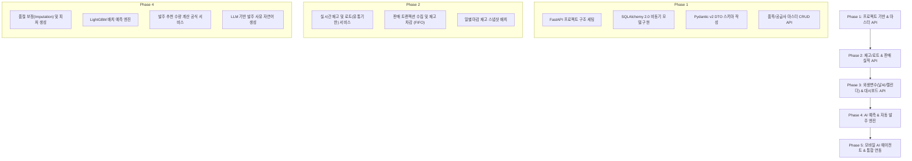

# Mart AI ERP - FastAPI 백엔드 개발 기능 명세서

본 문서는 **ERP 기반 AI 수요 예측 및 자동 발주 시스템(Mart AI ERP)**의 백엔드 구축을 위한 기능 명세서입니다.  
이미 구축된 **PostgreSQL 16 DB([DB_DESIGN.md](file:///c:/Users/quddb/Desktop/market_aierp/DB_DESIGN.md))**, **React 웹 프론트엔드**, **Expo 모바일 앱** 및 **[수요예측 데이터 명세.md](file:///c:/Users/quddb/Desktop/market_aierp/수요예측%20데이터%20명세.md)**를 완벽하게 연동할 수 있도록 Python FastAPI 기반의 요구사항과 API 아키텍처를 상세히 정의합니다.

---

## 1. 백엔드 아키텍처 및 기술 스택

### 1.1 기술 스택
| 영역 | 기술 / 라이브러리 | 용도 및 선정 이유 |
|---|---|---|
| **Web Framework** | **FastAPI** (Python 3.11+) | 고성능 비동기(ASGI) API, 자동 OpenAPI(Swagger) 문서화 |
| **ORM / DB Driver** | **SQLAlchemy 2.0 (Async) + asyncpg** | PostgreSQL 완전 비동기 처리, 타입 힌트 기반 안전성 |
| **Validation / DTO** | **Pydantic v2** | 고속 데이터 검증, 직렬화/역직렬화 |
| **AI / Machine Learning** | **LightGBM**, **Prophet**, **Pandas**, **NumPy** | 일별 수요 예측 배치 추론, 품절 보정(Censored Data Imputation) |
| **LLM Agent** | **OpenAI API / Gemini API (LangChain)** | 자동 발주 추천 사유 자연어 생성, 모바일 대화형 에이전트 |
| **Scheduler** | **APScheduler** or **FastAPI BackgroundTasks** | 기상청 단기예보 주기적 수집, 일일 재고 스냅샷, 야간 예측 배치 |
| **외부 연동 API** | **공공데이터포털 API** (기상청 단기예보, 한국천문연구원 특일) | 외생 변수(날씨, 공휴일, 설/추석 D-Day) 자동 적재 |

### 1.2 디렉터리 구조 설계 (Layered Architecture)
```text
backend/
├── app/
│   ├── api/
│   │   └── v1/
│   │       ├── endpoints/
│   │       │   ├── auth.py             # 인증 및 사용자 관리
│   │       │   ├── items.py            # 품목 마스터 API
│   │       │   ├── suppliers.py        # 공급업체 및 계약조건 API
│   │       │   ├── inventory.py        # 실시간 재고 및 로트(유통기한) API
│   │       │   ├── sales.py            # 판매 트랜잭션 및 통계 API
│   │       │   ├── promotions.py       # 가격 및 프로모션 API
│   │       │   ├── weather.py          # 기상청 날씨 및 예보 API
│   │       │   ├── forecasts.py        # AI 수요 예측 결과 조회/실행 API
│   │       │   ├── purchases.py        # 발주 추천 및 발주서(PO) API
│   │       │   ├── dashboard.py        # 웹/모바일 종합 대시보드 API
│   │       │   └── agent.py            # 모바일 AI 에이전트 챗봇 API
│   │       └── router.py               # v1 라우터 통합
│   ├── core/
│   │   ├── config.py                   # 환경변수 및 Pydantic Settings
│   │   ├── database.py                 # Async Engine & SessionFactory
│   │   └── security.py                 # JWT 토큰 및 비밀번호 해싱
│   ├── models/                         # SQLAlchemy 2.0 ORM 매핑 (DB_DESIGN 일치)
│   ├── schemas/                        # Pydantic v2 Request/Response DTO
│   ├── services/                       # 핵심 비즈니스 로직 계층
│   │   ├── inventory_service.py        # 재고 차감/입고, 위험도 판별 로직
│   │   ├── replenishment_service.py    # 발주 수량 공식 계산 로직
│   │   ├── weather_crawler.py          # 기상청 단기예보 API 클라이언트
│   │   └── llm_agent_service.py        # 발주 사유 자연어 요약 및 챗봇
│   ├── ml/                             # AI 모델 학습 및 추론 파이프라인
│   │   ├── feature_store.py            # 외생변수 결합 피처 테이블 생성기
│   │   ├── stockout_imputer.py         # 품절일 수요 복원 알고리즘
│   │   └── forecast_engine.py          # LightGBM 추론 엔진 (yhat, p10, p90)
│   └── main.py                         # FastAPI App 시작점 및 미들웨어
├── requirements.txt                    # 의존성 패키지 목록
└── .env                                # DB URL 및 외부 API 키
```

---

## 2. 도메인별 기능 상세 명세

### 기능 1: 기준 마스터 데이터 관리 (Master Data)
시스템 운영의 근간이 되는 품목, 공급업체, 창고, 고객사 정보를 제공합니다.

- **1.1 품목 관리 (`/api/v1/items`)**:
  - 품목 등록/수정/조회/단종 처리 (대·중·소 분류 필터링 지원).
  - 유통기한(일수), 권장 안전재고, 박스 입수량(`pack_size`), 기준 원가/판가 관리.
  - 대체 가능 품목군(`substitute_group`) 설정 (품절 시 대체품 추천 연계).
- **1.2 공급업체 및 계약조건 관리 (`/api/v1/suppliers`, `/api/v1/supply-terms`)**:
  - 공급업체 기본 정보 (연락처, 마감시간 `cutoff_time`, 최소발주금액).
  - 품목별 공급 계약 조건: 리드타임(일), 최소 주문 수량(MOQ), 발주 단위 배수(`order_multiple`), 매입 단가, 발주 가능 요일.
- **1.3 창고/매장 지점 및 거래처 관리 (`/api/v1/warehouses`, `/api/v1/customers`)**:
  - 지점 코드별 기상청 지역코드(`region_code`) 매핑.
  - B2B 거래처 등급(`segment`: A/B/C) 및 거래처별 주문 이력 관리.

---

### 기능 2: 실시간 재고 & 유통기한(로트) 관리 (Inventory & Batch)
웹과 모바일의 `Inventory`, `Expiry` 화면과 직결되는 실시간 재고 모니터링 기능입니다.

- **2.1 실시간 재고 현황 및 위험도 판별 (`/api/v1/inventory/current`)**:
  - 품목별 `현재고(On-hand)` 및 `가용재고(Available)` 계산 (미출고 수주량 차감).
  - 재고 상태(`StockStatus`) 자동 분류:
    - `normal`: 정상 재고
    - `low`: 현재고 < 안전재고 (`safety_stock`)
    - `out`: 재고 0 (품절)
    - `expiring`: D-3 이내 유통기한 임박 로트 존재
- **2.2 로트(Batch) 단위 유통기한 관리 (`/api/v1/inventory/batches`)**:
  - 입고 시점별 소비기한(`expiry_date`)과 수량을 로트 단위로 분할 관리.
  - 유통기한 D-Day 계산:
    - D-3 이내 긴급 품목 리스트업 (할인 프로모션 등록 트리거 제공).
    - 만료 품목 자동 폐기 처리 및 손실액 계산 (`qty * cost_price`).
- **2.3 일별 재고 마감 스냅샷 자동 생성 (`/api/v1/inventory/snapshot`)**:
  - 매일 자정(23:59) 지점별 일마감 재고를 `inventory_daily`에 저장.
  - 당일 품절 발생 여부(`stockout_flag`)를 판정하여 머신러닝 학습 데이터 오염 방지.

---

### 기능 3: 판매 트랜잭션 및 수주 관리 (Sales & Orders)
POS 단말기 및 온라인 쇼핑몰과 연동되는 실적 데이터 처리 기능입니다.

- **3.1 판매/출고 등록 및 반품 처리 (`/api/v1/sales`)**:
  - 판매 거래 라인 등록 시 해당 품목의 로트 재고를 선입선출(FIFO)로 자동 차감.
  - 반품 발생 시 `is_return = True` 플래그 및 재고 복원 처리.
- **3.2 판매 통계 및 트렌드 조회 (`/api/v1/sales/analytics`)**:
  - 일별/월별 매출액, 순판매수량(`net_qty`), 객단가, 채널별(`offline`/`online`/`b2b`) 비중 집계.
  - 과거 실적과 AI 예측치 간의 오차율 비교 데이터 제공.
- **3.3 B2B 확정 주문 잔량 관리 (`/api/v1/open-orders`)**:
  - 미래 납기 요청일(`requested_delivery_date`)을 가진 확정 주문 등록.
  - 단기(1~2주) 발주량 산출 시 확정 수요로 직접 합산 반영.

---

### 기능 4: 외생 변수 자동 수집 및 피처 스토어 (External Features)
AI 수요 예측의 정확도를 좌우하는 날씨, 캘린더, 프로모션 데이터를 가공합니다.

- **4.1 기상청 API 연동 실측 및 단기예보 파이프라인 (`/api/v1/weather`)**:
  - 공공데이터포털 기상청 단기예보 API를 호출하여 지점별 격자(nx, ny) 예보 데이터 적재.
  - 최고/최저 기온, 강수확률(POP), 강수량(PCP) 수치화 파싱 및 `weather_forecast` 테이블 저장.
  - 기상청 ASOS 과거 일자료 자동 동기화 (`weather` 테이블).
- **4.2 캘린더 및 명절 특일 엔진 (`/api/v1/calendar`)**:
  - 공휴일 여부, 설날/추석 D-Day (`days_to_seollal`, `days_to_chuseok`), 월말 급여일 여부 계산.
- **4.3 가격 및 프로모션 관리 (`/api/v1/promotions`)**:
  - 할인율, 1+1, 번들 행사 기간 등록.
  - 과거 행사 여부가 AI 피처에 0/1 플래그로 반영되도록 연동.
- **4.4 품절일 수요 복원(Imputation) 및 피처 스토어 (`/api/v1/ml/features`)**:
  - `stockout_flag = True`인 날의 판매량 왜곡을 방지하기 위해 최근 동일 요일 정상일 평균으로 타깃값을 복원(Impute).
  - 과거 판매량(Lag 1, 7, 14, 28일), 이동평균(MA 7, 28일), 외생변수를 결합한 모델 입력 테이블(`feature_table`) 생성.

---

### 기능 5: AI 수요 예측 엔진 (Forecasting Engine)
학습된 머신러닝 모델을 통해 미래 수요를 기간별로 예측합니다.

- **5.1 배치 예측 실행 (`/api/v1/ai/forecast/run`)**:
  - 매일 새벽, 전 품목에 대해 향후 7~14일간의 일별 수요 예측 배치 실행.
  - 중앙값($\hat{y}$), 하위 10%($p10$), 상위 10%($p90$)를 산출하여 `forecast` 테이블에 적재.
- **5.2 예측 결과 시각화 API (`/api/v1/ai/forecast`)**:
  - 특정 품목에 대한 과거 30일 실판매량과 향후 14일 예측 곡선(신뢰구간 밴드 포함) 데이터 반환.

---

### 기능 6: AI 자동 발주 추천 및 발주서(PO) 워크플로우
본 시스템의 핵심 비즈니스 가치로, 복잡한 발주 계산을 자동화합니다.

- **6.1 자동 발주 추천 알고리즘 (`/api/v1/purchases/recommend`)**:
  - **계산 공식**:
    $$\text{필요 수요} = \sum_{t=1}^{\text{LeadTime} + \text{ReviewPeriod}} \hat{y}_t + \text{안전재고}$$
    $$\text{부족 수량} = \max(0, \; \text{필요 수요} - \text{현재 가용재고} - \text{입고 예정량})$$
    $$\text{최종 추천량} = \max(\text{MOQ}, \; \lceil \frac{\text{부족 수량}}{\text{OrderMultiple}} \rceil \times \text{OrderMultiple})$$
- **6.2 LLM 기반 발주 사유 자연어 생성 (`/api/v1/ai/explain`)**:
  - 생성된 추천 발주량에 대해 사장님이 신뢰할 수 있도록 직관적인 설명 텍스트 자동 생성.
  - *예시: "리드타임(3일) 동안 주말 진입 및 32℃ 폭염 예보로 음료 수요 25% 급증 예상. 안전재고(20개) 확보를 위해 1박스(12개) 단위 올림하여 60EA 추천"*
- **6.3 발주서(PO) 생성 및 상태 전이 워크플로우 (`/api/v1/purchases/orders`)**:
  - 사장님이 웹/모바일에서 [승인] 버튼 클릭 시 추천 내역을 공급업체별 발주서(PO)로 자동 패키징.
  - 상태 전이 관리: `draft(초안)` $\to$ `ordered(발주완료)` $\to$ `partial(부분입고)` $\to$ `received(입고완료)`.
  - 입고 완료 시 `inventory_batches`에 신규 로트 재고 자동 적재 및 실제 리드타임 오차 기록.

---

### 기능 7: 대시보드 요약 및 모바일 AI 에이전트 챗봇
웹과 모바일 클라이언트가 즉시 소비할 수 있는 고수준 통합 인터페이스입니다.

- **7.1 사장님 맞춤 일일 대시보드 (`/api/v1/dashboard/summary`)**:
  - 당일 예상 매출 및 전주 대비 증감률.
  - 품절 품목 수, 유통기한 D-3 임박 품목 수, 금일 추천 발주 건수 및 예상 발주 총액.
  - 사장님이 오늘 처리해야 할 To-Do 리스트 자동 생성.
- **7.2 모바일 대화형 AI 에이전트 (`/api/v1/agent/chat`)**:
  - 자연어 대화 기반 재고/발주 조회 (RAG / Tool Calling 구현).
  - *질의 예시*:
    - *"오늘 우유 재고 얼마나 남아있어?"* $\to$ 현재고 및 소비기한 안내.
    - *"내일 비 온다는데 파전/막걸리 발주 어떻게 해야 해?"* $\to$ 기상 예보 및 추천 발주 카드 반환.
  - 단순 텍스트 답변뿐만 아니라 클릭 가능한 액션 카드(`cards`) 응답 지원.

---

## 3. RESTful API 엔드포인트 명세 목록

| 도메인 | HTTP | URI 경로 | 기능 요약 | 요청/응답 주요 내용 |
|---|---|---|---|---|
| **Dashboard** | `GET` | `/api/v1/dashboard/summary` | 일일 종합 대시보드 지표 | 매출, 품절수, 유통기한임박수, 발주추천 요약 |
| **Items** | `GET` | `/api/v1/items` | 품목 목록 조회 (검색/필터) | 카테고리, 검색어, 재고 위험도 필터 |
| | `POST` | `/api/v1/items` | 신규 품목 등록 | 품목명, 카테고리, 바코드, 단가, 안전재고 |
| | `GET` | `/api/v1/items/{item_id}` | 품목 상세 정보 조회 | 품목 기본정보 + 로트별 재고 + 공급조건 |
| **Inventory** | `GET` | `/api/v1/inventory/current` | 실시간 재고 및 위험도 조회 | 품목별 현재고, 가용재고, 위험상태(`low`/`out`) |
| | `GET` | `/api/v1/inventory/batches` | 유통기한/로트별 재고 목록 | 소비기한 D-Day, 임박 품목 정렬, 손실 위험액 |
| | `POST` | `/api/v1/inventory/adjust` | 재고 실사 및 수량 수동 조정 | 품목 ID, 조정 수량, 사유 (파손, 분실 등) |
| **Sales** | `POST` | `/api/v1/sales` | 판매 트랜잭션 기록 (출고) | 주문번호, 품목, 수량, 판매단가, 채널 |
| | `GET` | `/api/v1/sales/summary` | 판매 실적 및 통계 | 기간별 매출 추이, 카테고리 비중, 베스트셀러 |
| **Forecast** | `GET` | `/api/v1/forecast/{item_id}` | 특정 품목 수요 예측 조회 | 향후 14일 일별 `yhat`, `p10`, `p90` 시계열 데이터 |
| | `POST` | `/api/v1/forecast/run-batch` | 예측 파이프라인 수동 실행 | 실행 기준일, 대상 지점 |
| **Purchases** | `GET` | `/api/v1/purchases/recommend` | 오늘자 AI 발주 추천 목록 | 추천수량, 예상수요, 가용재고, LLM 산출사유 |
| | `POST` | `/api/v1/purchases/recommend/{rec_id}/action` | 추천 발주 승인/수정/거절 | 승인 수량 변경, 상태(`approved`/`rejected`) |
| | `POST` | `/api/v1/purchases/orders` | 발주서(PO) 최종 발행 | 공급사별 발주서 생성 (`status: ordered`) |
| | `GET` | `/api/v1/purchases/orders` | 발주서 목록 조회 | 공급사별, 상태별(`draft`/`ordered`/`received`) |
| | `POST` | `/api/v1/purchases/orders/{po_id}/receive` | 입고 확인 및 로트 재고 반영 | 실제 입고 수량, 소비기한 입력 |
| **External** | `GET` | `/api/v1/weather/forecast` | 지점별 날씨 예보 조회 | 기온(최고/최저), 강수확률, 비 여부 |
| | `GET` | `/api/v1/promotions` | 진행 중/예정 프로모션 조회 | 행사 품목, 할인가, 행사 기간 |
| **AI Agent** | `POST` | `/api/v1/agent/chat` | 모바일 AI 챗봇 질의응답 | 사용자 메시지 $\to$ DB Tool 조회 기반 답변 + 액션 카드 |

---

## 4. 백엔드 단계별 구축 로드맵



### 단계별 세부 계획
1. **Phase 1: 기반 인프라 및 마스터 API (1~2일차)**:
   - FastAPI 환경 설정, PostgreSQL 비동기 세션(`asyncpg`) 연결.
   - 18개 DB 테이블과 1:1 매핑되는 SQLAlchemy 모델 및 Pydantic 스키마 정의.
   - 품목, 공급업체, 창고 CRUD API 개발.
2. **Phase 2: 재고/로트 & 판매 실적 API (3~4일차)**:
   - 로트 단위 소비기한 만료 알림 및 재고 위험도(`StockStatus`) 판별 서비스.
   - 판매 등록 시 재고 차감 및 반품 처리 로직 구현.
   - 웹(`src/screens/Inventory.tsx`, `Expiry.tsx`) 및 모바일 실시간 연동.
3. **Phase 3: 외생 변수 수집 & 대시보드 API (5일차)**:
   - 기상청 단기예보 Open API 연동 수집기 구현.
   - 캘린더 공휴일 및 명절 D-Day 엔진 구현.
   - 웹/모바일 홈 대시보드 통합 API (`/dashboard/summary`) 구축.
4. **Phase 4: AI 수요 예측 & 자동 발주 추천 엔진 (6~7일차)**:
   - 과거 판매 집계 및 결측/품절 보정(`stockout_flag`) 피처 엔지니어링.
   - LightGBM 추론 파이프라인 구축 (`forecast` 적재).
   - 리드타임, 안전재고, MOQ, 배수를 반영한 발주량 자동 계산 서비스.
   - OpenAI/Gemini 기반 발주 사유 자동 생성기 탑재.
5. **Phase 5: 모바일 AI 에이전트 & E2E 테스트 (8일차)**:
   - 사장님 질문에 DB 쿼리를 연계하는 AI 챗봇 엔드포인트(`agent.py`) 완성.
   - 프론트엔드 목업(`mock.ts`)을 실제 FastAPI 서버 호출로 전면 전환 및 통합 검증.
