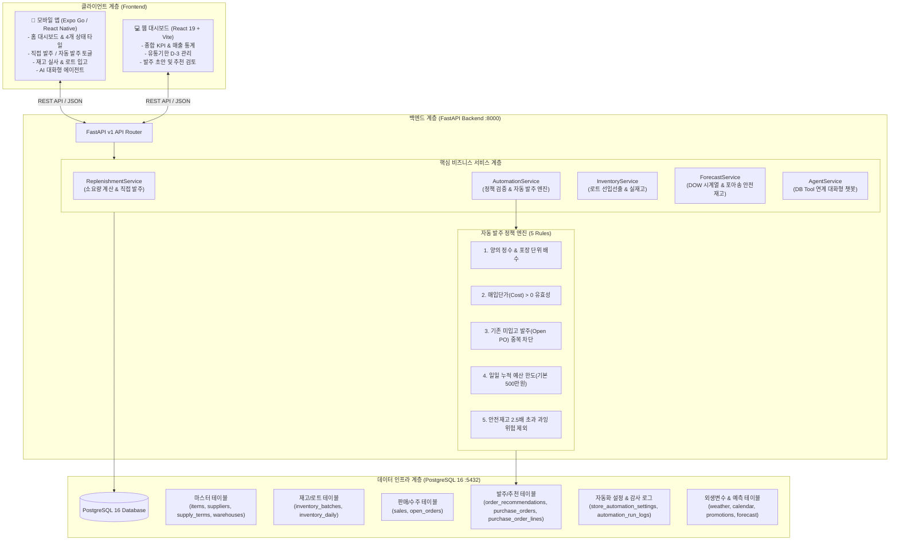
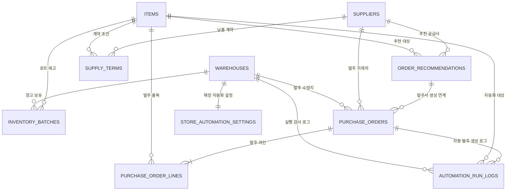

  # 🛒 Mart AI ERP (마켓 AI ERP)

> **개인 운영 중소형 마트를 위한 AI 수요 예측 & 자동 발주 최적화 모바일 ERP 솔루션**  
> 복잡하고 무거운 대기업형 ERP 대신, 마트 운영의 핵심인 **실시간 재고 관리**, **소비기한(로트) 관리**, **AI 수요 예측**, **스마트 발주(원클릭 직접 발주 & 서버 정책 기반 자동 발주)**, **모바일 대화형 AI 에이전트**에 집중한 차세대 통합 플랫폼입니다.

---

## 📌 목차
1. [프로젝트 개요 및 핵심 가치](#1-프로젝트-개요-및-핵심-가치)
2. [전체 시스템 아키텍처](#2-전체-시스템-아키텍처)
3. [핵심 기능 및 비즈니스 로직](#3-핵심-기능-및-비즈니스-로직)
4. [디렉터리 구조](#4-디렉터리-구조)
5. [데이터베이스 설계 (ERD)](#5-데이터베이스-설계-erd)
6. [API 엔드포인트 명세](#6-api-엔드포인트-명세)
7. [설치 및 실행 가이드 (Quick Start)](#7-설치-및-실행-가이드-quick-start)
8. [테스트 및 품질 검증](#8-테스트-및-품질-검증)
9. [관련 문서 링크](#9-관련-문서-링크)

---

## 1. 프로젝트 개요 및 핵심 가치

중소형 동네 마트는 유통기한이 짧은 신선식품과 회전율이 빠른 공산품을 동시에 다루지만, 인력과 예산의 한계로 **엑셀이나 사장님의 직관(경험)**에만 의존하여 발주를 진행하는 경우가 많습니다. 이로 인해 **품절로 인한 기회 손실**과 **과잉 발주로 인한 폐기 손실**이 반복됩니다.

**Mart AI ERP**는 이러한 페인 포인트를 해결하기 위해 다음의 가치를 제공합니다:

- **AI 시계열 수요 예측 (`dow-seasonal-v1`)**: 요일별 판매 패턴, 날씨(기온·강수확률), 공휴일 및 명절 D-Day 외생변수를 반영한 일별 판매량 정밀 예측.
- **안전재고 및 발주량 최적화 알고리즘**: 서비스 수준 95% 기준 포아송 수요 분산 공식($\sigma_{LT} = \sqrt{\text{LeadTime Demand}}$)을 적용하여 품절 위험을 방지하고 박스 입수량(배수) 및 MOQ를 자동 계산.
- **이중화된 발주 프로세스 지원**:
  1. **사장님 직접 발주 (Direct Order)**: AI 추천 수량을 직관적으로 확인하고, 필요 시 원클릭 수량 조절 후 즉시 발주서(PO) 발행.
  2. **완전 자동 발주 (Autonomous Ordering)**: 자동 발주 설정을 ON으로 켠 매장에 한해 서버 작업자가 5대 운영 정책(양의 정수, 단가 유효성, 중복 미입고 방지, 일일 예산 한도, 과잉 재고 리스크 차단)을 실시간 검증하여 자동 발행 및 감사 로그 기록.
- **입고 중심 실재고 통제**: 발주서 생성만으로는 재고가 늘지 않으며, 실물 도착 후 소비기한과 함께 입고 확인 시에만 새로운 로트(Batch)가 생성되어 현재고에 가산.
- **모바일 맞춤형 POS UI & 대화형 AI 에이전트**: 매장 현장을 돌아다니며 스마트폰(Expo Go)으로 재고 실사, 발주 승인, 입고 등록, 자연어 챗봇 질의응답 가능.

---

## 2. 전체 시스템 아키텍처



---

## 3. 핵심 기능 및 비즈니스 로직

### 3.1 4가지 재고 위험 상태 분류 및 우선순위 타일
모바일 홈 상단에는 매장 운영자가 즉시 인지해야 할 4가지 대표 품목이 상태별 색상 카드로 배치됩니다:
1. **재고 부족 (`low`, 파란색)**: 현재고가 안전재고 미만으로 떨어져 긴급 발주가 필요한 품목.
2. **소비기한 주의 (`expiring`, 노란색)**: 유통기한 만료 D-3 이내 로트가 존재하여 할인 행사나 긴급 판매가 필요한 품목.
3. **품절 (`out`, 회색)**: 현재고가 0인 결품 상태 품목.
4. **과잉 재고 위험 (`overstock_risk`, 빨간색)**: 안전재고 대비 재고량이 2배 이상 과다하여 추가 발주를 억제해야 하는 품목.

### 3.2 AI 발주 소요량 계산 공식
`backend/app/services/replenishment_service.py`에서 매일 아침 자동으로 계산됩니다:

$$\text{안전재고 (Safety Stock)} = z \times \sqrt{\sum_{t=1}^{L} \hat{y}_t} \quad (z = 1.65, \text{서비스 수준 } 95\%)$$

$$\text{필요 수요량 (Gross Demand)} = \sum_{t=1}^{L + R} \hat{y}_t + \text{안전재고}$$

$$\text{순 부족 수량 (Shortage)} = \max(0, \; \text{필요 수요량} - \text{현재 가용재고} - \text{입고 예정 수량})$$

$$\text{최종 추천량} = \max\left(\text{MOQ}, \; \left\lceil \frac{\text{순 부족 수량}}{\text{OrderMultiple}} \right\rceil \times \text{OrderMultiple}\right)$$

### 3.3 직접 발주 (Direct Order) vs 완전 자동 발주 (Autonomous Ordering)

| 구분 | 사장님 수동 직접 발주 | AI 완전 자동 발주 |
|---|---|---|
| **트리거** | 모바일 화면에서 [발주하기] 버튼 클릭 | 매장 자동화 설정 ON 토글 및 백그라운드 스케줄 |
| **수량 결정** | 사장님이 추천 수량을 직접 증감 수정 | AI 예측 추천 수량 그대로 발주 |
| **정책 검증** | 클라이언트 입력값 양의 정수 검증 | 5대 서버 정책(정수, 단가, 중복, 예산 한도, 과잉위험) 엄격 검증 |
| **발주서 발행** | 단일 추천 대상 즉시 `PurchaseOrder` 생성 | 정책 통과 품목 대상 PO 생성, 미달 품목은 사유와 함께 제외(`skipped`) |
| **발주 출처** | `source = "manual"` | `source = "automation"`, `automation_run_id` 연계 |
| **감사 로그** | 발주 내역 테이블에 기록 | `automation_run_logs`에 실행 ID, 원본/최종 수량, 판정 사유 영구 기록 |

### 3.4 로트 단위 입고 및 재고 반영
- 발주 완료 시점에는 재고가 증가하지 않고 `PurchaseOrderLine.order_qty`로 기록되어 입고 대기 상태 유지.
- 물품 수령 후 `/api/v1/purchases/orders/{po_id}/receive` 엔드포인트를 통해 실제 입고 수량 및 소비기한(`expiry_date`)을 입력하면 `InventoryBatch` 테이블에 신규 로트가 생성되어 실재고에 합산.

---

## 4. 디렉터리 구조

```text
market_aierp/
├── backend/                            # FastAPI 비동기 백엔드 서버
│   ├── app/
│   │   ├── api/v1/
│   │   │   ├── endpoints/
│   │   │   │   ├── agent.py            # 모바일 AI 대화형 에이전트 API
│   │   │   │   ├── automation.py       # AI 자동 발주 설정·실행·감사로그 API
│   │   │   │   ├── dashboard.py        # 대시보드 KPI 요약 API
│   │   │   │   ├── external.py         # 날씨·프로모션 외생변수 API
│   │   │   │   ├── forecasts.py        # 수요 예측 결과 시계열 API
│   │   │   │   ├── inventory.py        # 실시간 재고 & 소비기한 로트 API
│   │   │   │   ├── items.py            # 품목 마스터 CRUD API
│   │   │   │   ├── purchases.py        # 발주 추천, 직접 발주, 입고 처리 API
│   │   │   │   └── sales.py            # 판매 집계 및 트렌드 API
│   │   │   └── router.py               # v1 엔드포인트 통합 라우터
│   │   ├── core/
│   │   │   ├── config.py               # Pydantic Settings 환경변수 설정
│   │   │   └── database.py             # SQLAlchemy Async Engine & SessionFactory
│   │   ├── models/                     # SQLAlchemy 2.0 ORM 매핑 모델
│   │   │   ├── automation.py           # StoreAutomationSetting, AutomationRunLog
│   │   │   ├── features.py             # Weather, Calendar, Promotion, Forecast
│   │   │   ├── inventory.py            # InventoryDaily, InventoryBatch
│   │   │   ├── master.py               # Warehouse, Customer, Supplier, Item, SupplyTerm
│   │   │   ├── purchases.py            # PurchaseOrder, PurchaseOrderLine, OrderRecommendation
│   │   │   └── sales.py                # Sales, OpenOrder
│   │   ├── schemas/                    # Pydantic v2 DTO 스키마
│   │   └── services/                   # 비즈니스 로직 계층
│   │       ├── agent_service.py        # 챗봇 자연어 처리 및 도구 연계
│   │       ├── automation_service.py   # 자동 발주 정책 검증 & 실행 엔진
│   │       ├── dashboard_service.py    # 당일 지표 및 To-Do 생성
│   │       ├── forecast_service.py     # DOW 시계열 예측 모델
│   │       ├── inventory_service.py    # 재고 위험도 및 입고 예정량 산출
│   │       ├── replenishment_service.py# 소요량 공식 계산 & 직접 발주
│   │       └── sales_service.py        # 판매 실적 집계
│   ├── scripts/                        # 마이그레이션, 시드 생성, 테스트 스크립트
│   │   ├── migrate_automation_tables.py# 자동 발주 설정/로그 테이블 DDL 마이그레이션
│   │   ├── seed_four_display_items.py  # 4대 전시 품목(우유, 계란, 식빵, 생수) 시드
│   │   └── test_automation_api.py      # 자동 발주 API 통합 검증 스크립트
│   ├── generate_dataset.py             # 365일치 현실 판매/외생변수 시뮬레이션 데이터 생성기
│   ├── run.py                          # Uvicorn 서버 구동 스크립트 (Port 8000)
│   ├── requirements.txt                # 백엔드 의존성 패키지 목록
│   └── test_api.py                     # 백엔드 핵심 API 엔드포인트 전체 테스트
│
├── mobile/                             # Expo 모바일 프론트엔드 (React Native)
│   ├── app/                            # Expo Router 파일 기반 라우팅
│   │   ├── (tabs)/
│   │   │   ├── index.tsx               # 모바일 홈 (4개 타일 & 발주 추천)
│   │   │   ├── inventory.tsx           # 재고 목록 및 실사
│   │   │   ├── purchases.tsx           # 발주 목록 & 직접 발주
│   │   │   └── agent.tsx               # AI 챗봇 화면
│   │   ├── products/[id].tsx           # 상품 상세 정보
│   │   ├── purchase-orders/[id].tsx    # 발주서 상세 및 입고 등록
│   │   ├── sales.tsx                   # 판매 분석 화면
│   │   └── settings.tsx                # 매장 설정 및 자동 발주 모달
│   ├── src/
│   │   ├── components/pos/
│   │   │   └── AutomationControl.tsx   # 자동 발주 ON/OFF 스위치 및 감사로그 모달
│   │   ├── services/
│   │   │   ├── api/                    # 실서버 HTTP 통신 클라이언트 및 디코더
│   │   │   ├── mock/                   # 오프라인 발표/테스트용 Mock 서비스
│   │   │   ├── automation.ts           # 자동 발주 어댑터 인터페이스
│   │   │   └── recommendationDecisions.ts # 직접 발주 및 수량 결정 서비스
│   │   └── theme/                      # 모바일 UI 스타일 토큰
│   ├── tests/
│   │   ├── services.test.cjs           # 모바일 도메인 서비스 회귀 테스트 (37개)
│   │   └── automation-live.test.cjs    # Live 자동 발주 어댑터 전용 테스트
│   ├── .env.local                      # 모바일 환경 설정 (API 모드 및 LAN IP)
│   └── package.json                    # 모바일 패키지 정의
│
├── src/                                # 웹 프론트엔드 (React 19 + Vite)
│   ├── screens/                        # Home, Inventory, Expiry, Recommend, Draft
│   └── App.tsx                         # 웹 애플리케이션 진입점
│
├── docker/                             # Docker PostgreSQL 초기화 스크립트
│   └── init.sql                        # 데이터베이스 테이블 DDL 정의
├── docker-compose.yml                  # PostgreSQL(5432) & pgAdmin4(5050) 컨테이너 정의
├── DB_DESIGN.md                        # 데이터베이스 상세 물리/논리 설계서
├── FASTAPI_BACKEND_SPEC.md             # 백엔드 개발 기능 명세서
├── start_all.bat                       # 전체 서비스 원클릭 실행 배치 파일
├── start_backend.bat                   # 백엔드 실행 배치 파일
├── start_frontend.bat                  # 웹 프론트엔드 실행 배치 파일
├── start_mobile.bat                    # 모바일 Expo 실행 배치 파일
└── README.md                           # 프로젝트 메인 안내 문서
```

---

## 5. 데이터베이스 설계 (ERD)

PostgreSQL 16 기반으로 총 20개 이상의 도메인 테이블이 구축되어 있습니다:



### 주요 테이블 요약
- `warehouses`: 마트 지점 및 창고 정보.
- `items`: 상품 마스터 (규격, 입수량 `pack_size`, 안전재고, 원가, 판가, 소비기한).
- `suppliers` & `supply_terms`: 공급업체 기본 정보 및 품목별 리드타임, MOQ, 발주 배수.
- `inventory_batches`: 로트(Batch) 단위 실재고 및 소비기한(`expiry_date`) 관리.
- `order_recommendations`: AI가 생성한 일별 발주 추천 건 (`draft`, `approved`, `ordered`, `rejected`).
- `purchase_orders` & `purchase_order_lines`: 확정 발주서 헤더 및 라인 (`ordered`, `partial`, `received`).
- `store_automation_settings`: 매장별 자동 발주 활성화 여부(`enabled`), 버전 낙관적 락(`version`), 일일 예산 한도.
- `automation_run_logs`: 자동 발주 실행 건별 판정 감사 로그 (`created`, `skipped`, `failed`).

---

## 6. API 엔드포인트 명세

모든 API는 `/api/v1` 접두사를 가지며, FastAPI Swagger 문서(`http://localhost:8000/docs`)를 통해 대화형 테스트가 가능합니다.

| 도메인 | 메서드 | URI 경로 | 기능 설명 |
|---|---|---|---|
| **Dashboard** | `GET` | `/api/v1/dashboard/summary` | 당일 매출, 품절·임박 수, 추천 건수, To-Do 목록 조회 |
| **Inventory** | `GET` | `/api/v1/inventory/current` | 품목별 현재고, 가용재고, 위험 상태(`low`/`out`/`expiring`), 입고 예정량 조회 |
| | `GET` | `/api/v1/inventory/batches` | 로트별 소비기한 D-Day, 폐기 위험액 조회 |
| | `POST` | `/api/v1/inventory/adjust` | 재고 실사 및 오차 수량 수동 조정 |
| **Purchases** | `GET` | `/api/v1/purchases/recommend` | 오늘자 AI 추천 발주 목록 및 산출 사유 조회 |
| | `POST` | `/api/v1/purchases/recommend/{id}/action`| 추천 상태 변경 (`approve`, `modify`, `reject`) |
| | `POST` | `/api/v1/purchases/direct-order` | **(신규)** 모바일 AI 추천 1건 대상 즉시 발주서 발행 |
| | `GET` | `/api/v1/purchases/orders` | 발주서 목록 조회 (`source`, `status` 필터 지원) |
| | `POST` | `/api/v1/purchases/orders/{id}/receive` | 실제 입고 수량 및 소비기한 입력, 실재고(로트) 반영 |
| **Automation**| `GET` | `/api/v1/automation/settings` | **(신규)** 매장별 자동 발주 설정 및 일일 예산 한도 조회 |
| | `PUT` | `/api/v1/automation/settings` | **(신규)** 자동 발주 ON/OFF 저장 및 버전 충돌(409) 방지 |
| | `GET` | `/api/v1/automation/runs` | **(신규)** 자동 발주 정책 검증 감사 로그 및 처리 결과 조회 |
| | `POST` | `/api/v1/automation/trigger` | **(신규)** 서버 작업자 자동 발주 즉시 수동 실행 |
| **AI Agent**  | `POST` | `/api/v1/agent/chat` | 모바일 AI 챗봇 질의응답 (재고 확인, 발주 추천 카드 응답) |

---

## 7. 설치 및 실행 가이드 (Quick Start)

### 7.1 사전 요구사항
- **Windows / macOS / Linux**
- **Docker & Docker Compose** (PostgreSQL 구동용)
- **Python 3.11+** (가상환경 권장)
- **Node.js 20+** 및 **npm**
- **스마트폰**: Expo Go 앱 (Android Play Store 또는 iOS App Store)

---

### 7.2 전체 원클릭 실행 (Windows)
프로젝트 루트의 배치 파일을 실행하여 모든 컴포넌트를 한 번에 구동할 수 있습니다:
```cmd
start_all.bat
```
1. Docker PostgreSQL 컨테이너 자동 기동 (`:5432`)
2. FastAPI 백엔드 서버 기동 (`:8000`)
3. React 웹 프론트엔드 기동 (`:5173`)

---

### 7.3 컴포넌트별 수동 실행 가이드

#### 1) 데이터베이스 (Docker)
```bash
docker compose up -d
```
- PostgreSQL: `localhost:5432` (ID: `erp_user` / PW: `erp_password123!`)
- pgAdmin: `http://localhost:5050` (ID: `admin@market.com` / PW: `admin`)

#### 2) 백엔드 (FastAPI)
```bash
# 가상환경 활성화 (Windows)
backend\.venv\Scripts\activate

# 의존성 설치
pip install -r backend/requirements.txt

# DB 마이그레이션 및 시드 데이터 적재
python backend/scripts/migrate_automation_tables.py
python backend/scripts/seed_four_display_items.py

# 서버 구동
python backend/run.py
```
- API 서버: `http://localhost:8000`
- Swagger 문서: `http://localhost:8000/docs`

#### 3) 모바일 앱 (Expo)
```bash
cd mobile
npm install

# 실기기(Expo Go) 연동을 위한 LAN 모드 구동
# (호스트 PC Wi-Fi IP 주소가 172.31.149.191인 경우)
$env:REACT_NATIVE_PACKAGER_HOSTNAME="172.31.149.191"; npx expo start --lan
```
- **Expo Go 접속 주소**: `exp://172.31.149.191:8081`
- **웹 브라우저 접속**: `http://localhost:8081`

---

## 8. 테스트 및 품질 검증

본 프로젝트는 백엔드와 모바일 모두에 엄격한 단위/통합 테스트 스위트를 갖추고 있습니다.

### 8.1 모바일 테스트 (37/37 통과)
```bash
cd mobile
npm test
```
- 기본 Mock 모드 격리 검증
- AI 직접 발주 양의 정수 검증 및 재시도
- 자동 발주 중복 키 방지 및 서버 연동 어댑터 검증
- 기존 초안·발주·입고 파이프라인 무회귀 검증

### 8.2 모바일 정적 타입 검사
```bash
cd mobile
npm run typecheck
```
- TypeScript `tsc --noEmit` 무결성 검증 (오류 0건)

### 8.3 백엔드 API 종합 검증
```bash
# 기본 비즈니스 API 7개 검증 (대시보드, 재고, AI추천, 수요예측, 판매, 챗봇)
python backend/test_api.py

# AI 자동 발주 정책 및 감사 로그 검증
python backend/scripts/test_automation_api.py
```

---

## 9. 관련 문서 링크

- 📘 [데이터베이스 상세 물리/논리 설계서 (DB_DESIGN.md)](file:///c:/Users/quddb/Desktop/market_aierp/DB_DESIGN.md)
- 📋 [FastAPI 백엔드 개발 기능 명세서 (FASTAPI_BACKEND_SPEC.md)](file:///c:/Users/quddb/Desktop/market_aierp/FASTAPI_BACKEND_SPEC.md)
- 🤖 [AI 자동 발주 백엔드 인계 명세서 (mobile/AUTOMATION_BACKEND_HANDOFF.md)](file:///c:/Users/quddb/Desktop/market_aierp/mobile/AUTOMATION_BACKEND_HANDOFF.md)
- 📱 [AI 추천 직접 발주 API 계약서 (mobile/DIRECT_ORDER_API.md)](file:///c:/Users/quddb/Desktop/market_aierp/mobile/DIRECT_ORDER_API.md)
- 🚚 [모바일 백엔드 연동 가이드 (mobile/BACKEND_HANDOFF.md)](file:///c:/Users/quddb/Desktop/market_aierp/mobile/BACKEND_HANDOFF.md)
- 📲 [모바일 전용 README (mobile/README.md)](file:///c:/Users/quddb/Desktop/market_aierp/mobile/README.md)

---

### 💡 기여 및 브랜치 규칙
- 본 프로젝트는 `main` 브랜치에 직접 커밋하거나 푸시하지 않으며, 기능별 작업 브랜치(`feat/*`)에서 개발 및 검증 후 PR 리뷰를 통해 병합합니다.
- AI 예측 모델(`dow-seasonal-v1`)과 데이터베이스 무결성을 훼손하지 않는 것을 원칙으로 합니다.
